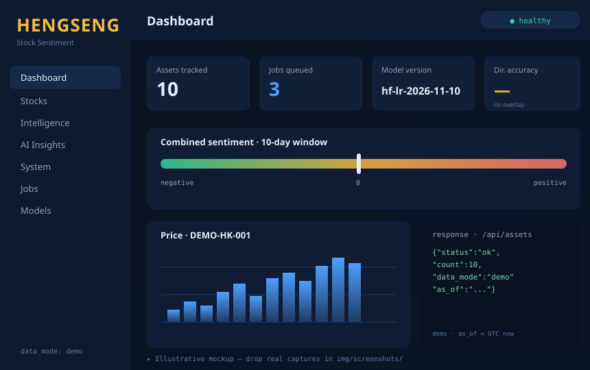
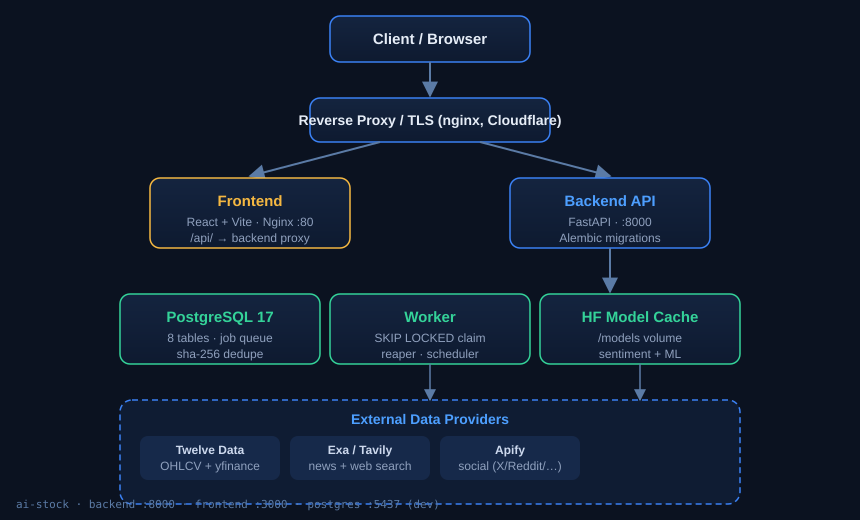
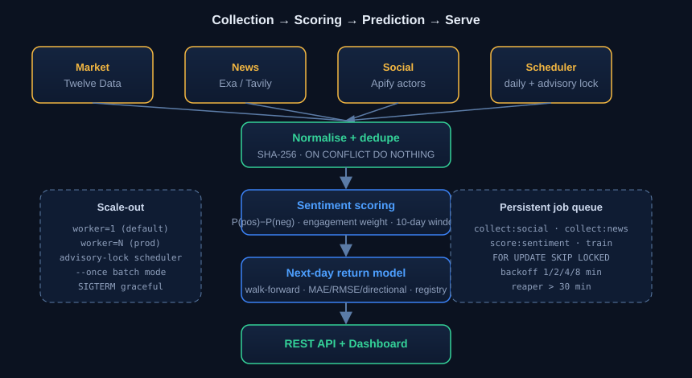

<div align="center">

# 📈 AI Stock Sentiment & Next-Day Prediction Agent

> **NEXTBELL** — a research platform that collects social posts + news for 10 major
> HKEX & KRX stocks, scores NLP sentiment, tracks price history, and serves
> **experimental** next-day-return predictions through a typed REST API + dashboard.

[](#license)
[](https://www.python.org/)
[](https://nodejs.org/)
[](https://fastapi.tiangolo.com/)
[](https://www.postgresql.org/)
[](https://www.docker.com/)
[](https://hub.docker.com/u/shresth7shukla)
[](#)
[](#disclaimer)

<br/>

**`⚠️ DISCLAIMER`** — This is a **research tool, not financial advice, and not a trading
bot.** It never recommends buying or selling. Past performance does not guarantee
future results. Use it to *understand* markets, not to trade them.

</div>

---

## ✨ What it does

```
   Social + News + Prices ──► NLP Sentiment ──► Walk-forward ML ──► REST API + Dashboard
        (collect)              (score)          (predict)            (serve)
```

The system ingests three data streams for each ticker, fuses them into a weighted
sentiment signal, feeds an experimental next-day-return model, and exposes everything
through a clean, documented API and a live dashboard. Every response is honestly
labelled with its `data_mode` (`demo` / `live`) and an `as_of` timestamp.

<table>
<tr>
<td width="50%">

**📥 Data collection**
- Market prices (OHLCV) — Twelve Data + keyless `yfinance` fallback
- News & web — Exa and Tavily search APIs
- Social — Apify actors (X / Reddit / …)
- SHA-256 content dedupe, `ON CONFLICT DO NOTHING`

</td>
<td width="50%">

**🧠 Sentiment engine**
- Score = `P(positive) − P(negative)`
- Engagement-weighted: `1 + ln(1 + engagement)`
- Combined signal: `0.4·social + 0.6·news` (configurable)
- Multi-language: English, 简中, 繁中, Korean
- 10-day rolling window · ±0.15 signal thresholds

</td>
</tr>
<tr>
<td width="50%">

**🔮 Experimental prediction**
- Target: next-day return (%)
- Walk-forward `TimeSeriesSplit` (gap=1, no leakage)
- Baselines: no-change & always-up
- Metrics: MAE · RMSE · directional accuracy
- Model registry with git-commit provenance

</td>
<td width="50%">

**🚀 Runtime**
- FastAPI + Pydantic, OpenAPI at `/api/openapi.json`
- PostgreSQL 17 job queue, `FOR UPDATE SKIP LOCKED`
- Concurrent workers, exponential backoff, stuck-job reaper
- React + Vite dashboard on Nginx, `/api/` proxied to backend

</td>
</tr>
</table>

---

## 📸 Screenshots

*Illustrative mockups generated for this page. Drop real captures into
`img/screenshots/` (e.g. `dashboard.png`) and update the paths below.*

<details>
<summary><b>🖥️ Dashboard (illustrative)</b></summary>



</details>

<details>
<summary><b>🏗️ System architecture</b></summary>



</details>

<details>
<summary><b>🔄 Data pipeline / workflow</b></summary>



</details>

> **Want a live look?** Run the stack in demo mode below and open
> http://localhost:3000 — the dashboard, jobs, and AI-insights pages render
> straight from the API with no external keys required.

---

## 🧭 Ticker universe

Ten proposed assets — **5 HKEX + 5 KRX**. Per project policy these are
**PENDING owner confirmation** and are not treated as live until confirmed.

| Exchange | Ticker | Symbol | Company |
|:--:|:--:|:--:|:--|
| HKEX | `0700` | `0700.HK` | Tencent |
| HKEX | `9988` | `9988.HK` | Alibaba |
| HKEX | `1810` | `1810.HK` | Xiaomi |
| HKEX | `3690` | `3690.HK` | Meituan |
| HKEX | `0005` | `0005.HK` | HSBC |
| KRX | `005930` | `005930.KS` | Samsung Electronics |
| KRX | `000660` | `000660.KS` | SK Hynix |
| KRX | `035420` | `035420.KS` | NAVER |
| KRX | `035720` | `035720.KS` | Kakao |
| KRX | `005380` | `005380.KS` | Hyundai Motor |

In **demo mode** the API serves a synthetic universe (`DEMO-HK-001`,
`DEMO-KR-001`) so the whole pipeline can be exercised without any credentials.

---

## 🚀 Quick start

### Prerequisites
- **Docker** 20.10+ and **Docker Compose** 2.0+
- An API key or two (only needed for `live` mode — **demo mode needs none**)

### 1 · Start in demo mode (no keys required)

```bash
git clone <this-repo>
cd "AI - Stock_Sentiment -Agent"

cp .env.example .env        # leave most keys empty for demo
docker compose up -d
```

Then open:

| Surface | URL |
|:--|:--|
| 🖥️ Dashboard | http://localhost:3000 |
| 🔌 API | http://localhost:8000/api |
| 📖 Swagger UI | http://localhost:8000/docs |
| 🧾 OpenAPI JSON | http://localhost:8000/api/openapi.json |

```bash
docker compose ps                     # all four services healthy?
curl http://localhost:8000/api/health # {"status":"ok", ...}
```

### 2 · Or run the prebuilt images straight from Docker Hub

The three service images are published under [`shresth7shukla`](https://hub.docker.com/u/shresth7shukla):

```bash
export DOCKERHUB_USERNAME=shresth7shukla
docker compose up -d
```

That pulls `shresth7shukla/ai-stock-{backend,frontend,worker}` instead of
building from source. (`local` is the default when the variable is unset.)

| Image | Role |
|:--|:--|
| `shresth7shukla/ai-stock-backend:1.0.0` | FastAPI + Alembic |
| `shresth7shukla/ai-stock-frontend:1.0.0` | React app on Nginx |
| `shresth7shukla/ai-stock-worker:1.0.0` | Background job processor |

---

## 🏗️ Architecture


Four services on one network (`stock_network`), one Postgres volume
(`postgres_data`) and one model-cache volume (`hf_models`):

| Service | Port | Purpose | User |
|:--|:--:|:--|:--|
| `postgres` | 5432 (host **5437**, dev only) | Primary store + job queue | `postgres` |
| `backend` | 8000 | REST API, migrations, health checks | `appuser` (UID 1000) |
| `frontend` | host 3000 → 80 | React SPA, proxies `/api/` to backend | `nginx` |
| `worker` | — | Claims & executes queued jobs | `appuser` (UID 1000) |

> **Frontend-agnostic backend.** The dashboard is a *disposable client* of the
> REST contract — swap it for any other UI without touching the backend.
> The handoff artifacts are `docs/openapi.json` and the generated TypeScript types.

---

## 🔄 Workflow / data pipeline


```
1. Collect   market (Twelve Data + yfinance) · news (Exa/Tavily) · social (Apify)
             │
             ▼
2. Persist   normalise → SHA-256 content hash → INSERT … ON CONFLICT DO NOTHING
             │  (dedupe is content-based, so re-runs never create duplicate rows)
             ▼
3. Score     per-item sentiment P(pos)−P(neg), engagement-weighted,
             then aggregate social + news over a 10-day window
             │
             ▼
4. Predict   walk-forward TimeSeriesSplit(gap=1); next-day return;
             MAE / RMSE / directional accuracy vs no-change & always-up baselines
             │  scalers fit INSIDE training folds — no data leakage
             ▼
5. Serve     REST API + dashboard; every response carries data_mode + as_of
```

**Jobs run through a persistent Postgres queue.** The worker claims work with
`UPDATE … FOR UPDATE SKIP LOCKED`, so many workers can run at once without
double-processing. Retries use exponential backoff, a reaper recovers jobs stuck
in `running` for > 30 min, and a single scheduler (guarded by an advisory lock)
creates the daily collection jobs.

| Job type | Purpose | Needs |
|:--|:--|:--|
| `collect:social` | scrape social posts | `APIFY_API_TOKEN` |
| `collect:news` | fetch news articles | `EXA_API_KEY`, `TAVILY_API_KEY` |
| `score:sentiment` | score + aggregate | local HF models (`/models`) |
| `train` | walk-forward model training | features + OOS holdout |

---

## 📚 API reference

All routes live under the `/api` prefix. Public reads need no key; the
collection/training and job endpoints require the admin key.

### System
| Method | Path | Auth | Purpose |
|:--|:--|:--:|:--|
| `GET` | `/api/health` | – | App liveness (200 while the process runs, regardless of DB) |
| `GET` | `/api/ready` | – | PostgreSQL readiness (200 up / **503** down) |
| `GET` | `/api/system/status` | – | Data mode, provider, configured/missing credentials, feature status |

### Data
| Method | Path | Auth | Purpose |
|:--|:--|:--:|:--|
| `GET` | `/api/assets` | – | List assets (paginated) |
| `GET` | `/api/assets/{ticker}` | – | One asset |
| `GET` | `/api/posts/{ticker}` | – | Social posts (paginated) |
| `GET` | `/api/news/{ticker}` | – | News articles (paginated) |
| `GET` | `/api/prices/{ticker}` | – | Market prices (paginated) |
| `GET` | `/api/sentiment/{ticker}` | – | Combined sentiment signal |
| `GET` | `/api/predictions/{ticker}` | – | Stored next-day predictions |
| `GET` | `/api/reports/overview` | – | System-wide overview |
| `GET` | `/api/reports/ranking` | – | Sentiment ranking |
| `GET` | `/api/reports/tickers` | – | Per-ticker, exchange-separated report |

### Models
| Method | Path | Auth | Purpose |
|:--|:--|:--:|:--|
| `GET` | `/api/models/evaluation` | – | MAE / RMSE / directional metrics |
| `GET` | `/api/models/versions` | – | Trained model versions |

### Jobs & collection (admin · `X-API-Key`)
| Method | Path | Purpose |
|:--|:--|:--|
| `GET` | `/api/jobs` | List queued/processed jobs |
| `GET` | `/api/jobs/{job_id}` | Inspect one job |
| `POST` | `/api/collect/run` | Queue per-ticker social/news collection → **202** (or **409** duplicate) |
| `POST` | `/api/models/train` | Queue a training job → **202** (or **409** duplicate) |

```bash
# public read — no key needed
curl http://localhost:8000/api/system/status

# admin trigger — requires API_ADMIN_KEY
curl -X POST -H "X-API-Key: $API_ADMIN_KEY" -H "Content-Type: application/json" \
     -d '{"tickers":["0700.HK"],"source":"all","label":"manual"}' \
     http://localhost:8000/api/collect/run
```

Every data response looks like:

```jsonc
{
  "data": [ /* … */ ],
  "meta": { "state": "ok", "data_mode": "demo", "as_of": "2026-11-12T09:30:00Z" }
}
```

`state` is honest: `ok`, `no_data`, or `insufficient_data` — the API never
fabricates rows to look busy.

---

## ⚙️ Configuration

Credentials live **only** in your local `.env` (git-ignored) — never in code,
images, git, or the frontend. Real environment variables always override `.env`.

| Variable | Default | Notes |
|:--|:--|:--|
| `DATA_MODE` | `demo` | `demo` \| `live`. Explicit — **never inferred** from key presence |
| `API_ADMIN_KEY` | *(empty)* | Protects admin/jobs routes; empty disables admin |
| `POSTGRES_HOST` / `POSTGRES_PORT` | `localhost` / `5437` | Compose overrides to `postgres`/`5432` |
| `POSTGRES_USER` / `POSTGRES_DB` | `stock` / `stock_sentiment` | |
| `MARKET_DATA_PROVIDER` | *(empty)* | e.g. `twelve_data` |
| `TWELVE_DATA_API_KEY` | *(empty)* | Market data |
| `EXA_API_KEY` / `TAVILY_API_KEY` | *(empty)* | News + web search |
| `APIFY_API_TOKEN` | *(empty)* | Social collectors |
| `HF_HOME` | `/models` | Hugging Face model cache volume |
| `CORS_ORIGINS` | localhost origins | Explicit list, **never `*`** |
| `DOCKERHUB_USERNAME` | `local` | Set to `shresth7shukla` to pull the published images |

### Demo vs live
- **`demo` (default):** deterministic in-memory universe, zero external calls.
- **`live`:** reads the Postgres store; empty/unavailable states are reported
  honestly (`no_data`, `insufficient_data`) rather than invented.
- Demo and live rows are **never mixed** in a single response.

---

## 🗄️ Database

PostgreSQL 17, **UTC everywhere**, tables created **only by Alembic**
(never `create_all`), running at startup when ≥ 1 migration exists.

| Table | Holds |
|:--|:--|
| `assets` | tickers & exchanges |
| `market_prices` | daily OHLCV |
| `social_posts` | X / Reddit / Telegram posts |
| `news_articles` | articles, deduped by content hash |
| `sentiment_results` | aggregated 10-day sentiment |
| `features` | engineered technical features |
| `model_evaluations` | ML metrics per version |
| `collection_jobs` | the worker job queue |

```bash
# migrations (auto-run on backend start; or manually)
docker compose exec backend alembic upgrade head
docker compose exec backend alembic current

# ad-hoc DB access (dev-only, host port 5437)
psql -h localhost -U stock -d stock_sentiment -p 5437
```

---

## 🔧 Running workers

```bash
# one-off batch (great for testing)
docker compose exec worker python -m app.workers.main --once

# scale out in production
docker compose -f docker-compose.prod.yml up -d --scale worker=3
docker compose -f docker-compose.prod.yml logs -f worker
```

Behaviours: concurrent `SKIP LOCKED` claiming · exponential backoff (1/2/4/8 min) ·
stuck-job reaper (> 30 min) · `SIGTERM` graceful shutdown · single scheduler via
`pg_try_advisory_lock` · idempotent `dedupe_key`.

---

## 🔒 Security

- **Admin auth** via `X-API-Key`, compared with `secrets.compare_digest` (no timing leak).
- **Secrets** stay in `.env` (git-ignored) / env vars — never logged, never in images.
- **CORS** uses an explicit origin list, never `*`.
- **Data isolation** — responses always carry `data_mode`; demo and live never mix.
- **Non-root** — backend & worker run as `appuser` (UID 1000); frontend as `nginx`.
- **No-data ≠ 0** — missing values surface as `null`/`no_data`, never fake zeros.

> For production, put TLS in front (nginx / Cloudflare / an ALB) and back up
> Postgres externally before going live.

---

## 🧪 Development & testing

```bash
# type-check / build the frontend
cd frontend && npm ci && npm run build

# run the backend test suite inside the container
docker compose exec backend python -m pytest tests/ -v
```

| Pinned | Version | Source of truth |
|:--|:--:|:--|
| Python | `3.12` | `backend/Dockerfile` (`python:3.12-slim`) |
| Node.js | `22` | `frontend/Dockerfile` (`node:22-alpine` → `nginx:alpine`) |

---

## 🧩 Troubleshooting

| Symptom | First move |
|:--|:--|
| Services won't start | `docker compose config` then `docker compose ps -a` |
| Backend unhealthy | `docker compose logs backend` — check `POSTGRES_*` vars |
| DB connect fails | `docker compose ps postgres`; confirm host port **5437** is free |
| Worker idle / jobs stuck | `docker compose logs -f worker`; check `collection_jobs` |
| API 401 | Confirm `API_ADMIN_KEY` is set **and** matches the `X-API-Key` you send |
| No sentiment | Is `/models` mounted? Did a `score:sentiment` job run? |
| No predictions | Need `market_prices` + `features` + a completed `train` job |

Full OpenAPI spec: http://localhost:8000/api/openapi.json

---

## 📦 Repository layout

```
.
├── backend/      FastAPI app, collectors, sentiment, ML, workers, Alembic
├── frontend/     React + Vite + Nginx dashboard
├── docker-compose.yml / docker-compose.prod.yml
├── .env.example  copy to .env; never commit the real one
├── img/          diagrams & screenshots for this README
└── LICENSE       MIT
```

---

## 🤝 Contributing

Open an issue or PR for bug reports, ideas, or improvements. The API contract and
the phase-by-phase history live in the project docs.

## ⚖️ License

Released under the **MIT License** — see [`LICENSE`](LICENSE). Research use; see
the disclaimer above.

---

<div align="center">

**Built with Python · FastAPI · PostgreSQL · React · Docker** — and a lot of `docker compose ps`.

</div>
